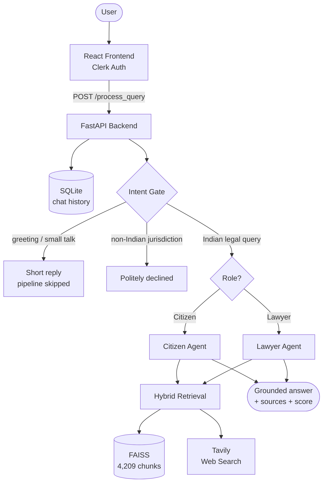

<div align="center">

# ⚖️ Nyaya AI

**An agentic, citation-grounded legal research assistant for Indian law.**

*Nyaya (न्याय) — "justice"*

[](https://www.python.org/)
[](https://fastapi.tiangolo.com/)
[](https://langchain-ai.github.io/langgraph/)
[](https://faiss.ai/)
[](https://groq.com/)
[](https://react.dev/)

</div>

---

## Overview

**Nyaya AI** turns a plain-English legal question into a researched, cited answer.

Rather than asking a language model to recall law from memory — which produces confident, fabricated citations — Nyaya AI runs a **multi-agent Retrieval-Augmented Generation (RAG)** pipeline. Every answer is grounded in documents retrieved at query time from a local corpus of **4,209 indexed chunks across 39 Indian legal documents**, combined with live web search.

It operates in two modes:

| Mode | Audience | Behaviour |
|------|----------|-----------|
| **Citizen** | General public | Plain-language guidance on rights, procedures, and statutes |
| **Lawyer** | Legal professionals | Issue extraction, multi-query research, drafting, and iterative self-critique |

---

## Key Features

- **🧠 Multi-agent orchestration** — Two distinct LangGraph state machines (13 nodes total), each tuned to its audience.
- **🔍 Hybrid retrieval** — FAISS semantic search over a local legal corpus, executed in parallel with Tavily live web search.
- **🛡️ Hallucination mitigation** — Answers are constrained to retrieved context. If nothing relevant is found, the system says so instead of inventing case law.
- **📊 Calibrated relevance filtering** — An empirically measured L2 distance cutoff (1.25) discards off-topic matches rather than padding results with noise.
- **🔁 Self-critique loop** — Lawyer mode drafts, scores, and revises its own answer until it clears a quality threshold.
- **📈 LLM-as-a-Judge evaluation** — Every answer is scored on relevance, faithfulness, and clarity, blended with semantic similarity.
- **🚪 Three-way intent gate** — Greetings, out-of-jurisdiction questions, and genuine legal queries are routed differently, cutting cost on non-legal traffic by ~97%.
- **💬 Conversational memory** — Follow-ups like *"what's the punishment for it?"* resolve correctly against earlier turns.
- **📎 Explainable output** — Sources and evaluation scores are surfaced behind expandable panels, never dumped into the answer.

---

## Architecture



### Citizen Agent

A linear RAG pipeline with a bounded research loop:

```
rewrite_query → perform_research → summarize_and_reflect → increment_counter
      ↓ (conditional)
   final_analysis → evaluate_response → END
```

### Lawyer Agent

An iterative *generate → critique → refine* loop:

```
issue_extractor → planner → retriever → drafter → critic
      ↓ score ≥ 0.7 or 3 iterations?
   yes → finalizer → END
   no  → back to planner
```

---

## How Retrieval Works

1. **Query rewriting** — The raw message is rewritten into a self-contained search query, resolving pronouns and references against conversation history.
2. **Parallel hybrid search** — FAISS vector search and Tavily web search run concurrently.
3. **Relevance filtering** — FAISS returns `k=8` candidates; only those within an L2 distance of **1.25** survive. This threshold was derived from measurement, not guesswork:

   | Query type | Observed L2 distance |
   |---|---|
   | In-domain legal query | 0.70 – 1.15 |
   | Out-of-corpus / off-topic | 1.31 – 1.76 |

   If nothing clears the bar, **zero** documents are returned — the system reports a gap rather than surfacing irrelevant sources.
4. **Domain filtering** — Social media and user-generated domains are blocked from being cited as legal sources.
5. **Grounded generation** — The model is instructed to cite only statutes, sections, and cases present in the retrieved context.

---

## Tech Stack

| Layer | Technology | Rationale |
|---|---|---|
| API | **FastAPI** | Async, Pydantic validation, auto-generated OpenAPI docs |
| Orchestration | **LangGraph** | Agents as explicit state machines — supports loops and conditional branching |
| LLM | **Groq · Llama 3.1 8B Instant** | Very low inference latency with a usable free tier |
| Vector store | **FAISS** | Local, in-memory, zero infrastructure |
| Embeddings | **all-MiniLM-L6-v2** (384-dim) | Compact, fast, strong general-purpose semantics |
| Web search | **Tavily** | Search API purpose-built for LLM agents |
| Persistence | **SQLite** | Lightweight thread and message storage |
| Frontend | **React 19 · Vite · Tailwind CSS** | Fast dev loop, utility-first styling |
| Auth | **Clerk** | Drop-in authentication and user management |

---

## Quick Start

### Prerequisites

- **Python 3.11** (required — some pinned wheels do not build on 3.13+)
- **Node.js 18+**
- API keys (all have free tiers):
  - [Groq](https://console.groq.com/keys) — LLM inference
  - [Tavily](https://app.tavily.com/) — web search
  - [Clerk](https://dashboard.clerk.com/) — frontend authentication

### 1. Clone

```bash
git clone https://github.com/Sanidhya-Jindal/nyaya-ai-.git
cd nyaya-ai-
```

### 2. Backend

```bash
cd backend

# Create and activate a virtual environment
python -m venv venv

# Windows
venv\Scripts\activate
# macOS / Linux
source venv/bin/activate

pip install -r requirements.txt
```

Create your environment file:

```bash
cp .env.example .env
```

Then fill in `backend/.env`:

```env
GROQ_API_KEY=your_groq_key_here
TAVILY_API_KEY=your_tavily_key_here
```

Run the API (**must be started from inside `backend/`** — data paths are relative):

```bash
python app.py
```

The API is now live at **http://127.0.0.1:8010**.

### 3. Frontend

In a second terminal:

```bash
cd frontend
npm install
cp .env.example .env
```

Fill in `frontend/.env`:

```env
VITE_CLERK_PUBLISHABLE_KEY=pk_test_your_clerk_key_here
```

Start the dev server:

```bash
npm run dev
```

Open **http://localhost:5173**, sign up, and start asking questions.

### Alternative: Streamlit UI

A standalone interface that needs no frontend build and no Clerk key:

```bash
cd backend
streamlit run streamlit_app.py
```

---

## Project Structure

```
nyaya-ai/
├── backend/
│   ├── app.py                     # FastAPI app, endpoints, response assembly
│   ├── db.py                      # SQLite thread + message persistence
│   ├── streamlit_app.py           # Optional standalone UI
│   ├── requirements.txt
│   ├── .env.example
│   │
│   ├── agent/
│   │   ├── router.py              # Intent gate + role-based routing
│   │   ├── citizen_agent.py       # Citizen LangGraph
│   │   └── lawyer_agent/
│   │       ├── __init__.py        # Lawyer LangGraph (critique loop)
│   │       ├── state.py           # Typed graph state
│   │       ├── legacy_answer.py   # Answer drafting
│   │       └── nodes/             # issue_extractor · planner · retriever
│   │                              # drafter · critic · finalizer
│   ├── legal_rag/
│   │   ├── query_rewriter.py      # History-aware query rewriting
│   │   ├── retrieval.py           # Hybrid FAISS + web retrieval
│   │   └── summarizer.py          # Summarisation, generation, evaluation
│   │
│   └── data/
│       ├── faiss_index/           # Prebuilt index + build script
│       └── indian_law_docs/       # 39 source legal documents
│
└── frontend/
    ├── src/
    │   ├── main.jsx               # Clerk + Router bootstrap
    │   ├── App.jsx                # Routing
    │   └── components/
    │       ├── ChatInterface.jsx        # Chat UI, roles, source panels
    │       └── ChatHistorySidebar.jsx   # Thread history
    └── .env.example
```

---

## API Reference

Base URL: `http://127.0.0.1:8010`

| Method | Endpoint | Description |
|---|---|---|
| `GET` | `/` | Health check |
| `POST` | `/process_query` | Run an agent; returns answer, sources, and evaluation |
| `POST` | `/get_chat_history` | List a user's conversation threads |
| `POST` | `/get_thread_messages` | Fetch messages in a thread |
| `POST` | `/save_thread` | Persist a thread |
| `DELETE` | `/delete_thread/{thread_id}` | Delete a thread and its messages |

**Example**

```bash
curl -X POST http://127.0.0.1:8010/process_query \
  -H "Content-Type: application/json" \
  -d '{
        "user_query": "What is Section 302 IPC?",
        "role": "citizen",
        "thread_id": "demo-1"
      }'
```

```json
{
  "final_analysis": "Section 302 of the Indian Penal Code deals with...",
  "thread_id": "demo-1",
  "evaluation": "Overall Quality Score: 4.1 / 5 ...",
  "sources": ["📄 ipc_qa", "🌐 Section 302 IPC — https://indiankanoon.org/..."]
}
```

---

## Configuration

Useful tuning knobs:

| Setting | Location | Default | Effect |
|---|---|---|---|
| `MAX_RESEARCH_CYCLES` | `agent/citizen_agent.py` | `1` | Research loop depth (higher = slower, more thorough) |
| `MAX_ITERATIONS` | `agent/lawyer_agent/__init__.py` | `3` | Lawyer critique-loop cap |
| `RELEVANCE_MAX_DISTANCE` | `legal_rag/retrieval.py` | `1.25` | FAISS relevance cutoff |
| `BLOCKED_WEB_DOMAINS` | `legal_rag/retrieval.py` | 14 domains | Sources excluded from citation |
| `FAST_MODE` | `legal_rag/summarizer.py` | `True` | Trim vs. chunk long context |

### Rebuilding the vector index

The repository ships with a prebuilt FAISS index. To rebuild after changing the corpus:

```bash
cd backend
python data/faiss_index/faiss_indexer.py
```

Documents are chunked at 1,000 characters with 100-character overlap.

> **Important:** the embedding model used to *query* the index must match the one used to *build* it. Both are `all-MiniLM-L6-v2`.

---

## Engineering Highlights

Notable design decisions worth calling out:

- **Isolated graph runs.** LangGraph's accumulating reducers (`operator.add`) combined with a checkpointer keyed on a stable thread ID caused sources from one question to leak into the next answer. Each run now gets its own checkpoint namespace, while conversational continuity is carried separately through chat history.
- **Context-aware query rewriting.** Follow-ups are resolved *before* retrieval, not after — otherwise "what's the punishment for it?" retrieves documents about generic fines instead of the subject under discussion.
- **Honest failure.** When both retrieval paths come back empty, the pipeline short-circuits to an explicit "no reliable information found" rather than invoking the model with no grounding.
- **Latency budget.** Restructuring the research loop, trimming token budgets, and adding retry handling across all seven inference call sites cut p50 latency from ~90s to ~22s.
- **Quality score, not accuracy score.** The self-evaluation metric is explicitly labelled as a measure of relevance and clarity, with a disclaimer that it is not a guarantee of legal correctness.

---

## Roadmap

- [ ] Corrective RAG (CRAG) — LLM-graded retrieval with conditional web fallback
- [ ] Self-RAG reflection tokens in Citizen mode
- [ ] Cross-encoder re-ranking after retrieval
- [ ] Domain-tuned legal embeddings (e.g. InLegalBERT)
- [ ] Streaming responses
- [ ] Offline evaluation harness with a labelled ground-truth set (precision@k, recall@k)

---

## Disclaimer

Nyaya AI is a **research and educational tool**. It does not provide legal advice, and its output should not be relied upon for any legal decision. Always verify cited acts, sections, and judgments against official sources, and consult a qualified advocate for matters that affect your rights.

---

## Acknowledgements

This project builds on the original **L.A.R.A (Legal Analysis & Research Assistant)** open-source project and its contributors. The backend agent orchestration, retrieval pipeline, grounding safeguards, and evaluation layer have been substantially reworked in this version.

Built with [LangGraph](https://langchain-ai.github.io/langgraph/), [FAISS](https://faiss.ai/), [Groq](https://groq.com/), [Tavily](https://tavily.com/), and [Sentence-Transformers](https://www.sbert.net/).
